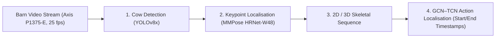

# Dairy Campus - Bovine Pose Estimation Dataset & Pipeline

[](https://doi.org/10.5281/zenodo.23931569)
[](https://creativecommons.org/licenses/by/4.0/)
[](https://www.python.org/)
[](https://pytorch.org/)
[](https://mmpose.readthedocs.io/)
[](https://docs.ultralytics.com/)

Official repository and codebase for top-down dairy cow detection, 4-point skeletal pose estimation, and posture-transition recognition, supporting the published dataset on Zenodo:

> **Zenodo Dataset:** [10.5281/zenodo.23931569](https://doi.org/10.5281/zenodo.23931569) *(All versions: [10.5281/zenodo.23931568](https://doi.org/10.5281/zenodo.23931568))*  
> **Associated Publication:** [WUR eDepot 654349](https://edepot.wur.nl/654349)  
> **Authors / Contributors:**  
> - **Bert Klandermans** (Data manager, Wageningen Livestock Research, WUR)  
> - **Claudia Kamphuis** (Project leader, Wageningen Livestock Research, WUR)  
> - **Marjaneh Taghavi** (Annotator, Wageningen Livestock Research, WUR)  
> - **Wijbrand Ouweltjes** (Annotator, Wageningen Livestock Research, WUR)  
> - **Rodania Bekhit** (Researcher, Wageningen Livestock Research, WUR)  

---

## 📌 Overview & Objectives

This codebase and dataset support bovine pose estimation, automated recognition of posture transitions (lying down and standing up), and general behaviors in dairy cows using top-view barn video recordings. Recorded at **Dairy Campus** (Leeuwarden, the Netherlands), the repository provides all scripts and configs to reproduce models, run benchmarks, and perform end-to-end inference for precision livestock farming.



### Anatomical Keypoints:
- `0: Left Ear`
- `1: Right Ear`
- `2: Withers (Schoft)`
- `3: Tail Base (Staartinplant)`

---

## 📊 Benchmark Results

Evaluated across the 20-image validation split (154 cows) and the complete 320-image dataset (2,525 cows):

| Model Architecture | Training Setup | Dataset Split | **mAP (COCO)** | AP@0.50 | AP@0.75 | AR | PCK@0.05 | PCK@0.10 | PCK@0.20 |
| :--- | :--- | :--- | :---: | :---: | :---: | :---: | :---: | :---: | :---: |
| 🥇 **HRNet-W48 (A100 Optimized)** | `bs=128, lr=0.002, ep180` | **Val (20 imgs)** | **61.84%** | 90.91% | **69.51%** | **70.41%** | **91.27%** | **97.75%** | 99.09% |
| 🥇 **HRNet-W48 (A100 Optimized)** | `bs=128, lr=0.002, ep180` | **All (320 imgs)** | **84.21%** | 87.10% | **86.44%** | 84.93% | **99.37%** | **99.80%** | **99.89%** |
| 🥈 **HRNet-W48 (A100 Final)** | `bs=128, lr=0.002, ep210` | **Val (20 imgs)** | **61.37%** | **92.15%** | 68.36% | 70.54% | **91.77%** | 97.68% | 98.82% |
| 🥈 **HRNet-W48 (A100 Final)** | `bs=128, lr=0.002, ep210` | **All (320 imgs)** | **84.51%** | 87.10% | 86.41% | **85.10%** | **99.43%** | 99.79% | 99.87% |
| 🥉 **HRNet-W48 (Paper Replay Best)** | `bs=2, lr=0.0005, ep180` | **Val (20 imgs)** | **59.79%** | 91.50% | 62.70% | 69.93% | 90.67% | 97.25% | 99.10% |
| 🥉 **HRNet-W48 (Paper Replay Best)** | `bs=2, lr=0.0005, ep180` | **All (320 imgs)** | **79.78%** | 87.09% | 85.78% | 80.97% | 99.22% | 99.68% | 99.80% |
| 🏅 **HRNet-W48 (Paper Replay Final)** | `bs=2, lr=0.0005, ep210` | **Val (20 imgs)** | **58.25%** | 89.07% | 61.64% | 68.65% | 90.06% | 96.82% | 99.03% |
| 🏅 **HRNet-W48 (Paper Replay Final)** | `bs=2, lr=0.0005, ep210` | **All (320 imgs)** | **81.32%** | 87.07% | 85.83% | 82.53% | 99.21% | 99.66% | 99.80% |
| 📄 **HRNet-W48 (Tomas Baseline)** | `bs=2, lr=0.0005, ep180` | **Val (20 imgs)** | **57.19%** | 89.96% | 61.30% | 66.82% | 89.52% | 97.11% | **99.30%** |
| 📄 **HRNet-W48 (Tomas Baseline)** | `bs=2, lr=0.0005, ep180` | **All (320 imgs)** | **81.14%** | 87.09% | 85.83% | 82.23% | 99.14% | 99.68% | 99.85% |

---

## 📂 Repository Layout

```
.
├── configs/
│   └── td-hm_hrnet-w48_8xb64-210e_ap10k-256x256.py  # MMPose model & dataset config
├── scripts/
│   ├── infer_cow_pose.py       # End-to-end inference demo (YOLO + HRNet)
│   ├── validate_mmpose.py      # Benchmark evaluation suite across models & splits
│   ├── validate_yolo.py        # YOLOv8 validation script
│   ├── train_a100_fast.py      # High-throughput A100 training script (bs=128)
│   ├── train_paper_replay.py   # Paper exact replication training script (bs=2)
│   └── build_combined_kpt.py   # Dataset builder (combines train + val splits)
├── slurm/
│   ├── train_a100_fast.slurm    # HPC batch script for high-throughput training
│   ├── resume_paper_model.slurm # HPC batch script for paper replication
│   └── run_benchmark_mmpose.slurm # HPC batch script for multi-model benchmark
├── results/
│   └── mmpose_benchmark_results.csv # Exported benchmark metrics
├── CITATION.cff                # Citation metadata for Zenodo & GitHub
├── requirements.txt            # Python dependencies
└── LICENSE                     # Open source license
```

---

## 🚀 Quickstart

### 1. Installation

```bash
git clone https://github.com/klandermans/dairy-cow-pose-estimation.git
cd dairy-cow-pose-estimation

# Install PyTorch with CUDA 12.1
pip install torch==2.1.2 torchvision==0.16.2 --index-url https://download.pytorch.org/whl/cu121

# Install OpenMMLab packages
pip install -U openmim
mim install mmengine==0.8.0 mmcv==2.1.0 mmpose==1.1.0

# Install remaining dependencies
pip install -r requirements.txt
```

### 2. End-to-End Inference Demo

```bash
python scripts/infer_cow_pose.py \
    --input sample_cow.jpg \
    --yolo-weights models/best_yolov8_390_10.pt \
    --pose-weights models/best_coco_AP_epoch_180.pth \
    --output results/detected_cows.jpg
```

### 3. Run Benchmark Suite

```bash
python scripts/validate_mmpose.py
```

---

## 🏛️ Funding & Acknowledgments

- **Policy Support Research:** Commissioned and funded by the Dutch Ministry of Agriculture, Nature, and Food Quality (*Future Food Systems*, project number **KB-53-000-001**).
- **Dairy Campus Innovation Fund:** Supported by the Regional Economic Program of Samenwerkingsverband Noord Nederland (**REP-SSN**).
- **Next Level Animal Sciences (NLAS):** Animal Sciences Group, Wageningen University & Research.
- **Noldus Information Technology:** Wageningen, the Netherlands.
- **European Union Horizon Europe Grants:**
  - European Partnership Animal Health and Welfare (**EUPAHW**, Grant agreement no. **101136346**).
  - Agriculture of Data (**AgData**, Grant agreement no. **101197332**).

---

## 📖 Citation

```bibtex
@misc{klandermans2026dairy,
  author       = {Klandermans, Bert and Kamphuis, Claudia and Taghavi, Marjaneh and Ouweltjes, Wijbrand},
  title        = {Dairy Campus - Bovine Pose Estimation Dataset},
  month        = nov,
  year         = 2026,
  publisher    = {Zenodo},
  doi          = {10.5281/zenodo.23931569},
  url          = {https://doi.org/10.5281/zenodo.23931569}
}
```
