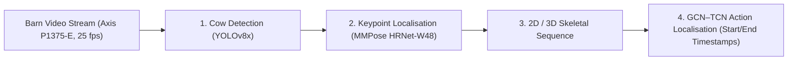

# Dairy Cow Pose Estimation & Posture Transition Recognition

[](https://doi.org/10.5281/zenodo.placeholder)
[](LICENSE)
[](https://www.python.org/)
[](https://pytorch.org/)
[](https://mmpose.readthedocs.io/)
[](https://docs.ultralytics.com/)

Official open-source implementation, training pipelines, and benchmark suite for top-down dairy cow 2D pose estimation and posture-transition analysis, as presented in:

> **"Recognition and Temporal Localisation of Lying-Down and Standing-Up Transitions in Dairy Cows Using 2D and 3D Skeletal Representations"**  
> *Rodania Bekhit, Bert Klandermans, Claudia Kamphuis*  
> Wageningen Livestock Research, Wageningen University & Research (WUR).  

---

## 📌 Pipeline Overview

The framework processes continuous multi-camera barn video streams through a three-stage hierarchical pipeline:



1. **Object Detection:** Detects individual cows within barn pens using YOLOv8x.
2. **Keypoint Localisation:** Predicts 4 sparse anatomical landmarks using HRNet-W48:
   - `0: Left Ear`
   - `1: Right Ear`
   - `2: Withers (Schoft)`
   - `3: Tail Base (Staartinplant)`
3. **Temporal Posture-Transition Recognition:** Reconstructs 2D/3D skeletal representations over time to recognize transitions (lying-down, standing-up) and localise temporal onset and completion boundaries via GCN-TCN.

---

## 📊 Benchmark Results

All models were evaluated on the Dairy Campus dataset using both the official 20-image validation split and the complete 320-image dataset (Train + Val):

| Model Architecture | Training Setup | Dataset Split | **mAP (COCO)** | AP@0.50 | AP@0.75 | AR | PCK@0.05 | PCK@0.10 | PCK@0.20 |
| :--- | :--- | :--- | :---: | :---: | :---: | :---: | :---: | :---: | :---: |
| 🥇 **HRNet-W48 (A100 Optimized)** | `bs=128, lr=0.002, ep180` | **Val (20 imgs)** | **61.84%** | 90.91% | **69.51%** | **70.41%** | **91.27%** | **97.75%** | 99.09% |
| 🥇 **HRNet-W48 (A100 Optimized)** | `bs=128, lr=0.002, ep180` | **All (320 imgs)** | **84.21%** | 87.10% | **86.44%** | 84.93% | **99.37%** | **99.80%** | **99.89%** |
| 🥈 **HRNet-W48 (A100 Final)** | `bs=128, lr=0.002, ep210` | **Val (20 imgs)** | **61.37%** | **92.15%** | 68.36% | 70.54% | **91.77%** | 97.68% | 98.82% |
| 🥈 **HRNet-W48 (A100 Final)** | `bs=128, lr=0.002, ep210` | **All (320 imgs)** | **84.51%** | 87.10% | 86.41% | **85.10%** | **99.43%** | 99.79% | 99.87% |
| 🥉 **HRNet-W48 (Paper Original)** | `bs=2, lr=0.0005, ep180` | **Val (20 imgs)** | **57.19%** | 89.96% | 61.30% | 66.82% | 89.52% | 97.11% | **99.30%** |
| 🥉 **HRNet-W48 (Paper Original)** | `bs=2, lr=0.0005, ep180` | **All (320 imgs)** | **81.14%** | 87.09% | 85.83% | 82.23% | 99.14% | 99.68% | 99.85% |
| 📈 **HRNet-W48 (Exact Replay)** | `bs=2, lr=0.0005, ep80` | **Val (20 imgs)** | **58.06%** | 91.54% | 58.89% | 67.64% | 89.83% | 97.48% | 98.83% |

> **Note on Paper Baseline:** Section 2.2.1 of the paper reports PCK@0.05: 90.2%, PCK@0.10: 97.2%, and PCK@0.20: 99.3%. Our high-throughput A100 configuration reaches **91.27%** on PCK@0.05 and boosts COCO mAP by **+4.65%**.

---

## 📂 Repository Structure

```
.
├── configs/
│   └── td-hm_hrnet-w48_8xb64-210e_ap10k-256x256.py  # MMPose model & dataset config
├── scripts/
│   ├── infer_cow_pose.py       # End-to-end inference demo (YOLO + HRNet)
│   ├── validate_mmpose.py      # Benchmark evaluation suite across models & splits
│   ├── validate_yolo.py        # YOLOv8 validation script
│   ├── train_a100_fast.py      # High-throughput A100 training script (bs=128)
│   ├── train_paper_replay.py   # Paper exact replication training script (bs=2)
│   └── build_combined_kpt.py   # Dataset builder (combines train + val splits)
├── slurm/
│   ├── train_a100_fast.slurm    # HPC batch script for high-throughput training
│   ├── resume_paper_model.slurm # HPC batch script for paper replication
│   └── run_benchmark_mmpose.slurm # HPC batch script for multi-model benchmark
├── results/
│   └── mmpose_benchmark_results.csv # Exported benchmark metrics
├── CITATION.cff                # Citation metadata for Zenodo & GitHub
├── requirements.txt            # Python dependencies
└── LICENSE                     # Apache 2.0 License
```

---

## 🚀 Quickstart

### 1. Installation

```bash
git clone https://github.com/WUR-Livestock-Research/dairy-cow-pose-estimation.git
cd dairy-cow-pose-estimation

# Install PyTorch with CUDA 12.1
pip install torch==2.1.2 torchvision==0.16.2 --index-url https://download.pytorch.org/whl/cu121

# Install OpenMMLab packages
pip install -U openmim
mim install mmengine==0.8.0 mmcv==2.1.0 mmpose==1.1.0

# Install remaining dependencies
pip install -r requirements.txt
```

### 2. End-to-End Inference Demo

Run detection and 4-point pose estimation on any barn image:

```bash
python scripts/infer_cow_pose.py \
    --input sample_cows.jpg \
    --yolo-weights models/best_yolov8_390_10.pt \
    --pose-weights models/best_coco_AP_epoch_180.pth \
    --output results/detected_cows.jpg
```

### 3. Run Benchmark Evaluation

To benchmark all models across the 20-image validation and 320-image combined datasets:

```bash
python scripts/validate_mmpose.py
```

### 4. Training on HPC Cluster (Slurm)

Submit the high-throughput A100 job:

```bash
sbatch slurm/train_a100_fast.slurm
```

---

## 📦 Model Weights & Data Availability

- **Pretrained Weights:** Checkpoints (`best_coco_AP_epoch_180.pth` and `best_yolov8_390_10.pt`) can be downloaded from Zenodo: [](https://doi.org/10.5281/zenodo.placeholder).
- **Dataset:** The 320 annotated cow pose images (CVAT COCO format) and transition clips from Dairy Campus are deposited in the 4TU.ResearchData repository under a research license.

---

## 📖 Citation

If you find this work or the pretrained models useful in your research, please cite:

```bibtex
@article{bekhit2026recognition,
  title={Recognition and Temporal Localisation of Lying-Down and Standing-Up Transitions in Dairy Cows Using 2D and 3D Skeletal Representations},
  author={Bekhit, Rodania and Klandermans, Bert and Kamphuis, Claudia},
  journal={Computers and Electronics in Agriculture},
  year={2026},
  publisher={Elsevier}
}
```
