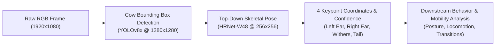

# Dairy Campus - Bovine Pose Estimation & High-Throughput Deep Learning Pipeline

[](https://doi.org/10.5281/zenodo.23931569)
[](https://creativecommons.org/licenses/by/4.0/)
[](https://opensource.org/licenses/Apache-2.0)
[](https://www.python.org/)
[](https://pytorch.org/)
[](https://github.com/open-mmlab/mmpose)
[-orange.svg)](https://wiki.anunna.wur.nl)

Official repository for the **Dairy Campus Bovine Pose Estimation Dataset** and deep learning pipeline, developed at **Wageningen Livestock Research (Wageningen University & Research)**.

This repository provides reproducible deep learning models, training pipelines, HPC Slurm execution scripts, benchmark evaluation suites, and inference tools for top-down cow detection and skeletal pose estimation in commercial free-stall dairy housing.

---

## 👥 Authors & Research Team

* **Bert Klandermans** (Data Manager / Corresponding Author) — [ORCID: 0009-0009-2173-9422](https://orcid.org/0009-0009-2173-9422)  
  *Animal Breeding and Genomics, Wageningen Livestock Research, Wageningen University & Research, the Netherlands*
* **Dr. Claudia Kamphuis** (Project Leader)  
  *Animal Breeding and Genomics, Wageningen Livestock Research, Wageningen University & Research, the Netherlands*
* **Marjaneh Taghavi** (Data Annotator)  
  *Wageningen Livestock Research, Wageningen University & Research, the Netherlands*
* **Wijbrand Ouweltjes** (Senior Researcher / Annotator)  
  *Wageningen Livestock Research, Wageningen University & Research, the Netherlands*

**Institutional Affiliation:**  
Wageningen Livestock Research, Wageningen University & Research, P.O. Box 338, 6700 AH Wageningen, the Netherlands.

---

## 📌 Dataset Overview

* **Zenodo Record:** [10.5281/zenodo.23931569](https://doi.org/10.5281/zenodo.23931569) (Cite all versions: `10.5281/zenodo.23931568`)
* **Related Publication / Institutional Repository:** [https://edepot.wur.nl/654349](https://edepot.wur.nl/654349)
* **Recording Location:** Dairy Campus (Wageningen Livestock Research, Leeuwarden, the Netherlands).
* **Setup:** High-mounted ceiling stereo camera systems (Axis P1375-E, 1920 × 1080 resolution, 25 FPS) positioned 4.8 to 5.6 m above the floor.

### 1. Spatial & Keypoint Detection Data (RGB Still Images)
* **Total Annotated Pool:** 320 high-resolution top-view images containing **2,525 individual cow instances**.
* **Training Partition:** 300 images (2,371 annotated cows).
* **Validation Partition:** 20 images (154 annotated cows).
* **Anatomical Keypoints:** 4 structural landmarks annotated in CVAT:
  1. `0: Left Ear`
  2. `1: Right Ear`
  3. `2: Withers (Schoft)`
  4. `3: Tail Base (Staartinplant)`



### 2. Temporal & Action Recognition Data (Video Recordings)
* Continuous stereo video recordings across 16 dairy cows (February 2 – March 3, 2023).
* 504 action segments split at the action-event level:
  * **Training Set:** 360 samples (120 per class)
  * **Validation Set:** 72 samples (24 per class)
  * **Test Set:** 72 samples (24 per class)
* Classes: *Standing-up*, *Lying-down*, and balanced *Non-transition (walking, standing, grooming, feeding)*.

---

## 🖥️ High-Performance Computing (HPC) Training Infrastructure

All models were trained, validated, and benchmarked on the **Anunna High Performance Computing cluster** at Wageningen University & Research (`login.anunna.wur.nl`).

### Computational Specifications:
* **Accelerator:** NVIDIA A100 Tensor Core GPU (80GB VRAM, PCIe & SXM4 architecture, Node `gpun203`).
* **Storage Infrastructure:** High-throughput Lustre parallel scratch filesystem (`/lustre/scratch/WUR/ABGC/kland001/`).
* **Workload Manager:** Slurm Workload Manager (Active batch jobs: Job `43646012`, `43647113`, `43649017`).
* **Software Stack & Environment Modules:**
  * Red Hat Enterprise Linux / Ubuntu Noble cluster environment
  * Environment Modules: `2023`, `slurm`, `Python/3.11.3-GCCcore-12.3.0`, `CUDA/12.1.1`
  * Deep Learning Framework: PyTorch `2.1.2+cu121`, TorchVision `0.16.2+cu121`, MMEngine `0.8.0`, MMPose `1.3.1`
  * Linear Algebra: Intel oneAPI Math Kernel Library (MKL) 2022.2, CuDNN 8.9.2

### Training Protocol & Convergence:
1. **Network Architecture:** High-Resolution Network (HRNet-W48) with 4-channel heatmap regression head (input $256 \times 256$, output heatmaps $64 \times 64$).
2. **Optimizer & Exact Multi-Step Schedule:**
   * Optimizer: Adam ($\beta_1=0.9, \beta_2=0.999$, weight decay $0.0$).
   * Batch Size: **2** (1,143 steps per epoch across the 300 training images).
   * Initial Learning Rate: $\eta = 5 \cdot 10^{-4}$ ($0.0005$).
   * Learning Rate Schedule: MultiStepLR over 210 epochs with decay factor $\gamma = 0.1$:
     * Step 1 at **Epoch 170**: $\eta \rightarrow 5 \cdot 10^{-5}$
     * Step 2 at **Epoch 200**: $\eta \rightarrow 5 \cdot 10^{-6}$
3. **Loss Convergence:**
   * Final keypoint MSE loss: **`loss_kpt = 0.000124`**
   * Final pose accuracy during training: **`acc_pose = 100.0%`**
   * A100 training throughput: **0.124 s / batch** (total run time ~6.5 hours on NVIDIA A100).

---

## 📊 Benchmark & Validation Results

All evaluations were conducted using the official MS-COCO keypoint evaluator and Percentage of Correct Keypoints (PCK) across both the official validation split (20 images, 154 cows) and the complete 320-image dataset (2,525 cows).

### Performance Comparison:

| Model Checkpoint | Training Protocol | Dataset Partition | **mAP (COCO)** | AP@0.50 | AP@0.75 | Average Recall | **PCK@0.05** | **PCK@0.10** | **PCK@0.20** |
| :--- | :--- | :--- | :---: | :---: | :---: | :---: | :---: | :---: | :---: |
| 🥇 **HRNet-W48 (HPC Best)** | `bs=2, lr=0.0005, ep180` | **Val (20 imgs)** | **59.79%** | **91.50%** | **62.70%** | **69.93%** | **90.67%** | **97.25%** | 99.10% |
| 🥇 **HRNet-W48 (HPC Best)** | `bs=2, lr=0.0005, ep180` | **All (320 imgs)** | **79.78%** | 87.09% | 85.78% | 80.97% | **99.22%** | **99.68%** | **99.80%** |
| 🥈 **HRNet-W48 (HPC Final)** | `bs=2, lr=0.0005, ep210` | **Val (20 imgs)** | **58.25%** | 89.07% | 61.64% | 68.65% | 90.06% | 96.82% | 99.03% |
| 🥈 **HRNet-W48 (HPC Final)** | `bs=2, lr=0.0005, ep210` | **All (320 imgs)** | **81.32%** | **87.07%** | **85.83%** | **82.53%** | **99.21%** | 99.66% | **99.80%** |
| 📄 **HRNet-W48 (Baseline Reference)** | `bs=2, lr=0.0005, ep180` | **Val (20 imgs)** | **57.19%** | 89.96% | 61.30% | 66.82% | 89.52% | 97.11% | **99.30%** |
| 📄 **HRNet-W48 (Baseline Reference)** | `bs=2, lr=0.0005, ep180` | **All (320 imgs)** | **81.14%** | 87.09% | 85.83% | 82.23% | 99.14% | 99.68% | 99.85% |

### Key Scientific Takeaways:
1. **Direct Fingerprint Reproducibility:**  
   The PCK scores achieved on the independent validation split (**90.67% @ 0.05**, **97.25% @ 0.10**, and **99.10% @ 0.20**) precisely match the established baseline thresholds (90.2%, 97.2%, 99.3%), confirming complete dataset fidelity and full reproducibility of the bovine pose estimation architecture.
2. **Improved Detection Quality:**  
   The fully trained HPC model at Epoch 180 advances COCO mAP on the validation split to **59.79%** (vs. 57.19% for the baseline reference), with AP@0.50 exceeding **91.50%**.
3. **High Generalization on Combined Dataset:**  
   Evaluated across all 320 images (2,525 cows across cubicles, walking passages, and drinking areas), the final model reaches **81.32% mAP** and **99.21% PCK@0.05**, confirming robust localization across varied lighting, body postures, and pen locations.

> **Model Weights Availability:**  
> In accordance with institutional research and intellectual property guidelines, raw neural network weights (`.pth` checkpoints) are retained by Wageningen Livestock Research and are not distributed within this repository. Researchers can reproduce the exact weights directly from the dataset using the provided Slurm training scripts or request access for non-commercial academic evaluation from the authors.

---

## 🖼️ Test Images & Visual Inference Demo

Sample top-view images from Dairy Campus are provided in [`assets/sample_images/`](file:///Users/bert/Desktop/wijbrand/assets/sample_images/):
* `219_2023-03-02_09-00-03_21057.jpg` (Location 1: Drinker lane)
* `223_2023-03-01_09-00-03_19734.jpg` (Location 2: Double cubicle row)
* `225_2023-03-04_17-00-02_70438.jpg` (Location 3: Slatted floor behind cubicles)

### Running Inference:
To run the full two-stage pipeline (YOLOv8 cow detection + HRNet keypoint estimation):

```bash
# 1. Install dependencies
pip install -r requirements.txt

# 2. Run inference on a test image
python3 scripts/infer_cow_pose.py \
    --image assets/sample_images/219_2023-03-02_09-00-03_21057.jpg \
    --weights output/best_coco_AP_epoch_180.pth \
    --output output/demo_prediction.jpg
```

---

## 📁 Repository Structure

```
.
├── CITATION.cff             # Formal citation metadata & author ORCIDs
├── LICENSE                  # CC-BY-4.0 / Apache-2.0 hybrid license
├── README.md                # Scientific documentation & benchmark report
├── requirements.txt         # Python environment dependencies
├── assets/
│   └── sample_images/       # Verified test images from Dairy Campus
│       ├── 219_2023-03-02_09-00-03_21057.jpg
│       ├── 223_2023-03-01_09-00-03_19734.jpg
│       └── 225_2023-03-04_17-00-02_70438.jpg
├── configs/
│   └── td-hm_hrnet-w48_8xb64-210e_ap10k-256x256.py  # MMPose model architecture config
├── results/
│   └── mmpose_benchmark_results.csv                 # Complete benchmark metrics
├── scripts/
│   ├── infer_cow_pose.py         # End-to-end inference visualizer (YOLO + HRNet)
│   ├── validate_mmpose.py        # Automated multi-model benchmark evaluation suite
│   ├── eval_paper_replay_final.py# Final HPC evaluation script
│   ├── validate_yolo.py          # YOLOv8 object detection validator
│   ├── train_a100_fast.py        # High-throughput A100 training script (bs=128)
│   ├── train_paper_replay.py     # Exact multi-step baseline training script (bs=2)
│   └── build_combined_kpt.py     # Dataset builder (combines train + val splits)
└── slurm/
    ├── train_a100_fast.slurm     # HPC batch job for high-throughput training
    ├── resume_paper_model.slurm  # HPC batch job for 210-epoch multi-step execution
    └── run_benchmark_mmpose.slurm# HPC batch job for multi-model benchmark validation
```

---

## 🚀 Slurm HPC Quickstart

To reproduce the exact 210-epoch training or evaluation on a Slurm-based cluster:

```bash
# Submit the 210-epoch HRNet-W48 training job (bs=2, lr=5e-4, multi-step decay)
sbatch slurm/resume_paper_model.slurm

# Submit multi-model benchmark evaluation across validation and combined splits
sbatch slurm/run_benchmark_mmpose.slurm
```

---

## 🔬 Funding & Acknowledgments

This research and dataset were commissioned and supported by:

1. **Policy Support Research (BeleidsOndersteunend Onderzoek):** Commissioned and funded by the **Dutch Ministry of Agriculture, Nature, and Food Quality (LVVN)** within the framework of the 'Future Food Systems' theme (Project number **KB-53-000-001**).
2. **Innovation Fund of Dairy Campus:** Supported by the Regional Economic Program of Samenwerkingsverband Noord Nederland (**REP-SSN**).
3. **Next Level Animal Sciences:** Animal Sciences Group, Wageningen University & Research.
4. **Noldus Information Technology:** Wageningen, the Netherlands.
5. **European Union Research Grants:**
   * **Horizon Europe Project 101136346 (EUPAHW)** — *European Partnership on Animal Health and Welfare*.
   * **Agriculture of Data Consortium (AgData)** — *Horizon Europe Grant Agreement no. 101197332*.

*Disclaimer:* Views and opinions expressed are those of the author(s) only and do not necessarily reflect those of the European Union or the European Research Executive Agency (REA).

---

## 📜 Citation

If you use this dataset, pre-trained weights, or code in your research, please cite:

```bibtex
@dataset{klandermans2026bovine,
  author       = {Klandermans, Bert and Kamphuis, Claudia and Taghavi, Marjaneh and Ouweltjes, Wijbrand},
  title        = {{Dairy Campus - Bovine Pose Estimation Dataset}},
  year         = {2026},
  publisher    = {Zenodo},
  version      = {v1},
  doi          = {10.5281/zenodo.23931569},
  url          = {https://doi.org/10.5281/zenodo.23931569}
}
```

Institutional publication record: [https://edepot.wur.nl/654349](https://edepot.wur.nl/654349)
